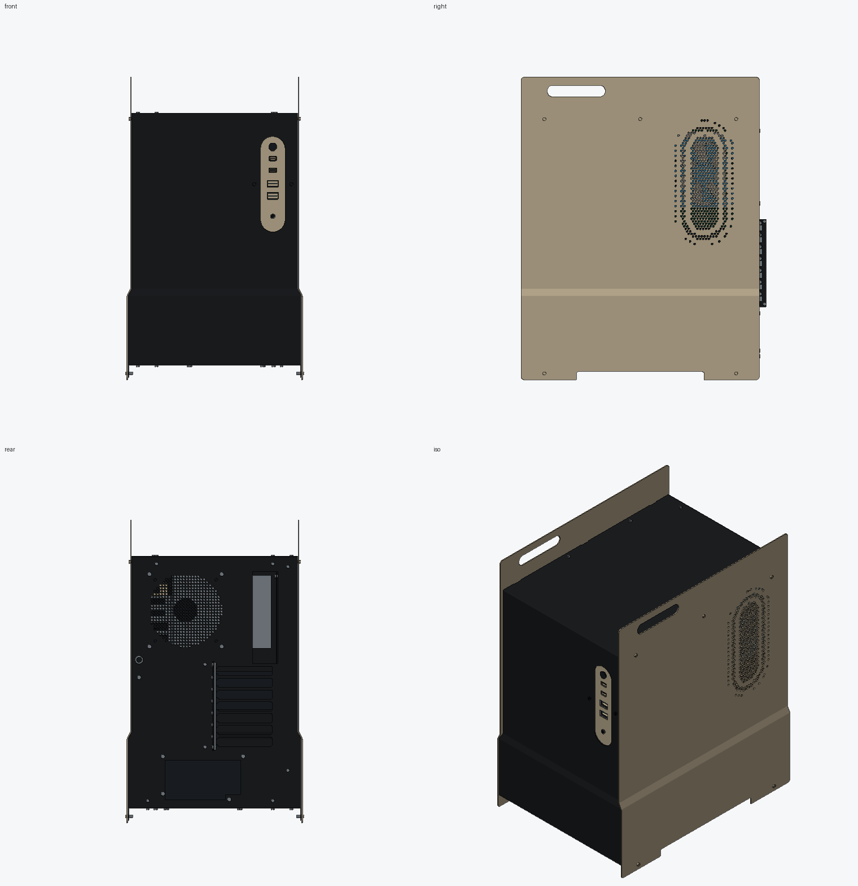
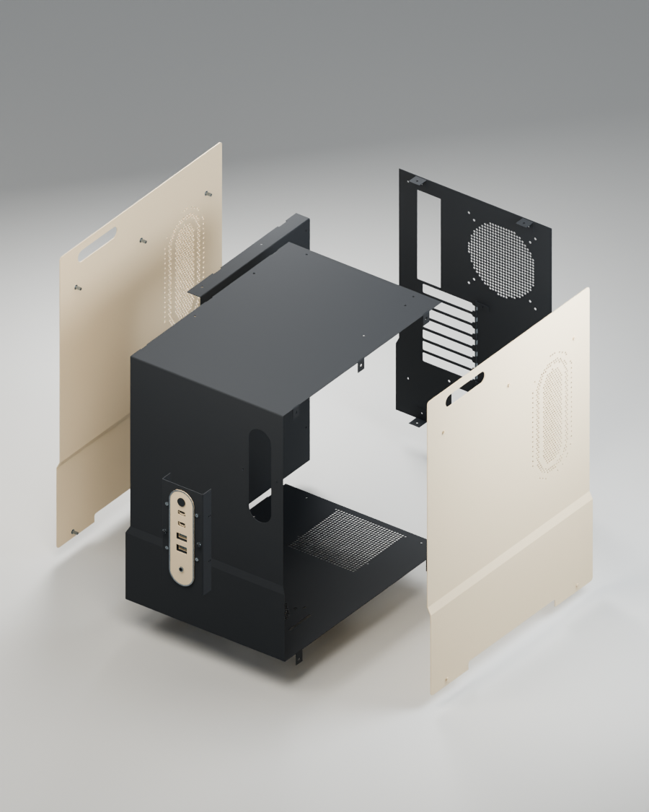
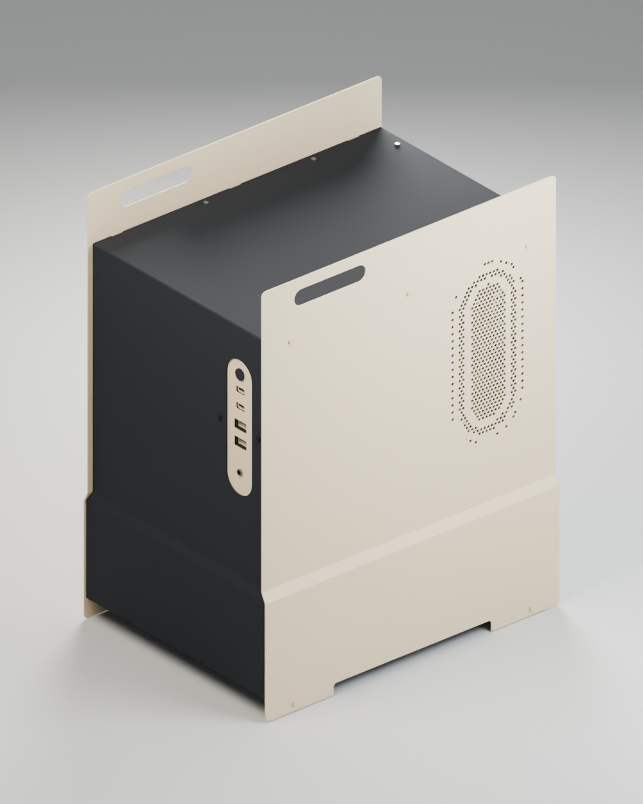
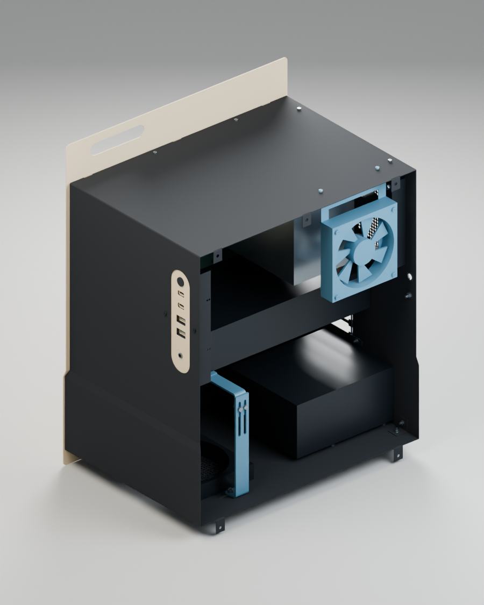
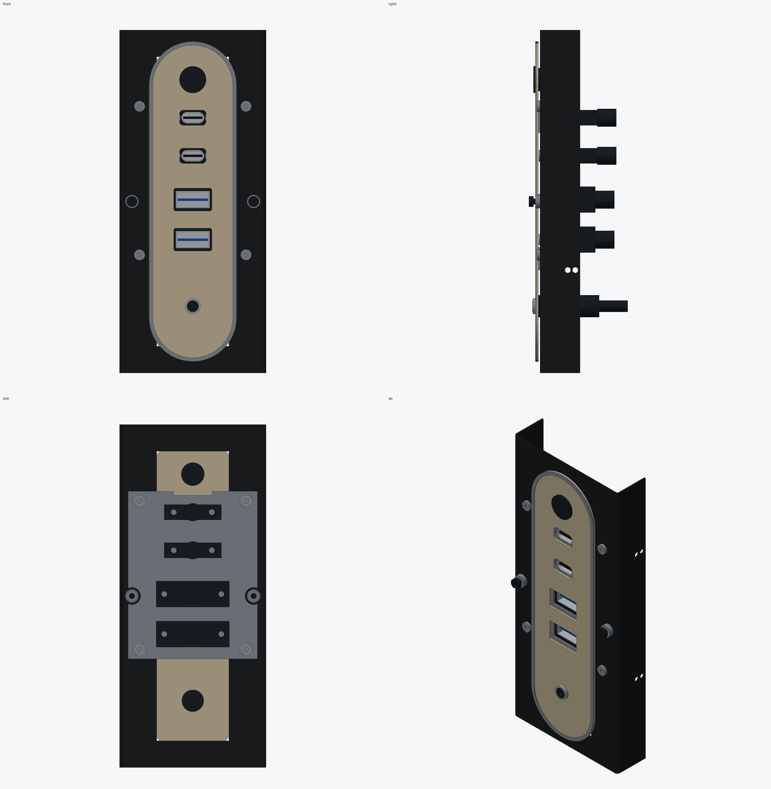
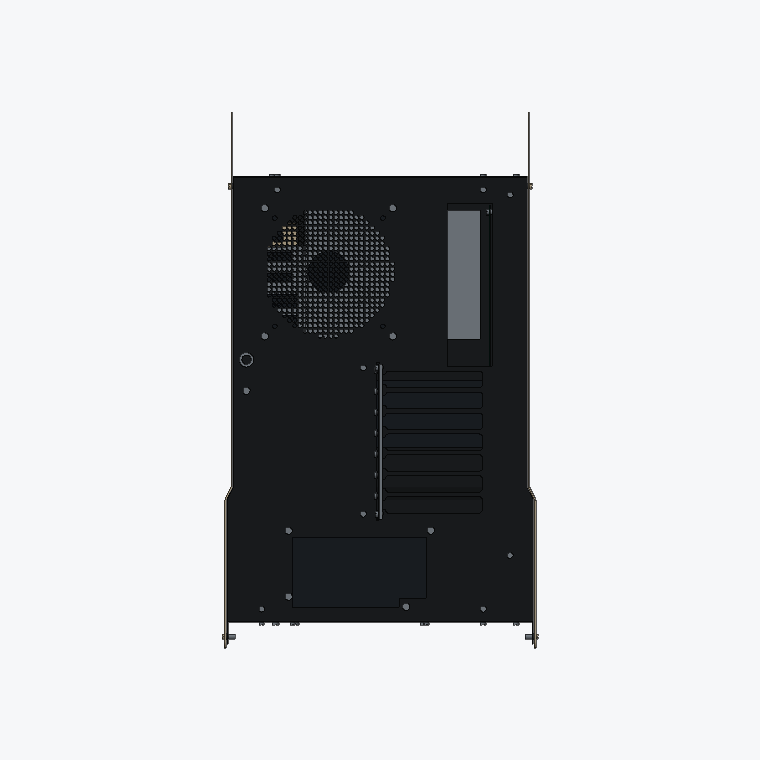

# Sheet Metal PC Case

[](LICENSE.txt)
[](#repository-contents)
[](Sheet%20Metal%20PC%20Case%20Drawings%20and%20Build%20Guide.pdf)
[](#physical-qualification-required)

An open-source, DIY sheet metal PC enclosure designed to be laser/waterjet cut from flat metal sheets, CNC or press-brake folded, and assembled with ordinary fasteners—no welding and no custom injection-molded parts.



> [!IMPORTANT]
> **This engineering design has not been physically prototyped.**
> All CAD geometry, flat-pattern developments, solid interferences, hole alignments, and cable clearances have been verified digitally. However, physical fabrication coupons, tool clearances, supplier bend allowances, electrical grounding continuity, PCI card fit, and thermal performance must be qualified before cutting a complete chassis. See [Physical Qualification Required](#physical-qualification-required) for details.

---

## Highlights

- **Sled Side Plates**: Each side sheet flows down into two continuous feet and rises into a forward handle opening, elevating the case off the desk without separate legs (handles are unrated; empty-case handling only until load-qualified).
- **Concentric Capsule Ventilation**: 546 staggered hexagonal holes (Ø3.5 mm) per side with solid aesthetic contour bands.
- **Formed Step Line**: A small formed joggle along the lower body adds rigidity and visual character without extra decorative parts.
- **No Welding**: 19 manufactured sheet parts (from 18 cut designs) joined with standard M3 screws, nuts, rivet nuts, and motherboard standoffs.
- **Modular Front I/O**: Accommodates dual USB-C, dual USB-A, 3.5 mm stereo audio, and a vandal-resistant power switch on a concealed sub-carrier plate. Alternative single-C, power-only, and fully blank fascia DXFs are included.
- **Complete Open-Source Package**: Includes native parametric FreeCAD files, neutral STEP assemblies, 29 production-ready DXFs, Python source automation scripts, complete CSV/JSON bills of materials, and a 41-page A3 fabrication manual.

---

## Assembly Overview



---

## Component Compatibility & Clearances

| Component | Target Specifications / Maximum Limits | Notes |
| :--- | :--- | :--- |
| **Motherboard** | ATX (up to 304.8 × 243.84 mm), Micro-ATX (243.84 × 243.84 mm), or Mini-ITX (170 × 170 mm) | E-ATX is not supported |
| **Graphics Card (GPU)** | Up to 340 mm length, 150 mm height projection, 65 mm thickness | Includes an additional 35 mm connector/cable bend allowance; optional G01/G02 GPU support included |
| **Power Supply (PSU)** | Standard ATX form factor (150 × 86 mm cross section, 140 to 180 mm depth) | Includes a 60 mm cable exit allowance |
| **CPU Cooler** | Up to 170 mm height clearance | Verify against socket placement, RAM height, and VRM heatsinks |
| **Cooling Fans** | 1× 140 mm bottom intake/exhaust, 1× 140 mm rear exhaust | Removable F01 side bracket supports an optional 120 mm fan |
| **Storage** | 1× 2.5″ SSD (7 mm thickness) | Dedicated mounting provision |
| **Chassis Envelope** | 302 mm W × 410 mm D × 520 mm H (main shell)<br>306.8 mm W × 422 mm D × 520 mm H (including pan heads and rear rail) | Upper width: 290 mm |

---

## Chassis Views

<p align="center">
  
  
</p>
<p align="center">
  
  
</p>

---

## Repository Contents

```
├── CAD/
│   ├── Sheet Metal PC Case.FCStd               # Master FreeCAD assembly (parts, hardware, routing allocations)
│   ├── Sheet Metal PC Case Flat Patterns.FCStd  # FreeCAD individual developed blanks
│   ├── Sheet Metal PC Case Assembly.step       # Colored STEP neutral solid assembly
│   └── Sheet Metal PC Case Sheet Parts.step    # 19 manufactured sheet parts only (uncolored)
├── DXF/
│   ├── C01.dxf – C04.dxf                       # Core structural brackets & nutstrips
│   ├── F01.dxf                                 # Optional 120 mm side fan bridge
│   ├── G01.dxf, G02.dxf                        # Optional GPU support & clamp
│   ├── I01.dxf – I03.dxf                       # Front I/O fascia and carrier plates
│   ├── M01.dxf – M03.dxf                       # Motherboard tray and interior rails
│   ├── R01.dxf                                 # Rear panel
│   ├── S01-S02.dxf                             # Opposite-handed side sled panels (cut from shared blank)
│   ├── T01.dxf, T02.dxf                        # Lower runner brackets
│   ├── W01.dxf                                 # 1238 mm outer wrap blank
│   ├── Alternatives/                           # 3 alternative fascias (single-C, power-only, fully blank)
│   ├── Ancillary-cuts/                         # Gasket (GSK01) and side head shims (SH01)
│   └── Process-coupons/                        # QC01–QC06 press-brake and tooling test coupons
├── Preview/                                    # Renderings (isometric, exploded, front, internal, I/O)
├── Source/                                     # Parametric Python rebuild pipeline & verification suite
│   ├── Approved-design.FCStd                   # Baseline geometric model
│   ├── detail.py                               # Rebuild script for detailed geometry
│   ├── finish_io.py                            # Idempotent I/O subsystem placement
│   ├── package_data.py                         # Schedules, JSONs, and CSV exporter
│   ├── build_guide.py                          # 41-page PDF drawing guide compiler (PyMuPDF)
│   ├── export_flats.py                         # 2D developed DXF exporter
│   ├── export_models.py                        # STEP assembly and sheet model exporter
│   └── check_*.py                              # Automated validation tests (development, assembly, IO, clearances)
├── Sheet Metal PC Case Drawings and Build Guide.pdf # 41-page A3 complete drawings & build manual
├── ASSEMBLY-NOTES.md                           # Chassis assembly notes & motherboard/PCI datums
├── IO-ASSEMBLY.md                              # Front I/O cable topology, adapters, and installation
├── LICENSE.txt                                 # CERN-OHL-P-2.0 open hardware license
├── NOTICE.md                                   # Third-party component attributions & trademarks
├── *.csv                                       # Bend, flat hole, joint, parts, hardware, and purchasing BOMs
└── *.json                                      # Digital verification, geometry, clearance, and schedule checks
```

---

## Materials & Manufacturing

The case is designed for standard sheet metal gauges and materials:

- **Sides (`S01`, `S02`)**: 1.5 mm Aluminium (5052-H32).
- **Outer Wrap (`W01`)**: 1.0 mm Mild Steel (blank length: ~1,238 mm).
- **Rear Panel (`R01`), Tray (`M01`), and Brackets**: 1.0 mm Mild Steel.
- **Fascia (`I01`)**: 1.0 mm Aluminium.
- **Nutstrip & GPU Support (`C01`, `G01`)**: 3.0 mm Mild Steel.
- **Gasket (`GSK01`)**: 0.5 mm non-conductive gasket material.
- **Shims (`SH01`)**: 0.2 mm shims.

### Fabrication Workflow

1. **Cut the blanks**: Cut profiles from the DXFs. Use the included process coupons (`DXF/Process-coupons/QC01-QC06`) to qualify your cutting kerf, hole tolerances, and bend deductions.
2. **Form the bends**: Follow `bend-schedule.csv` and the section drawings in the PDF guide. Confirm the bend allowance ($K$-factor) and tool access with your fabricator before bending the ~1,238 mm outer wrap.
3. **Deburr**: Deburr all laser/waterjet cut edges before and after bending. Relieve all handles, vent slots, and cable pass-throughs.
4. **Trial assembly**: Test-fit the bare metal parts using the specified M3 screws, rivet nuts, and standoffs per `joint-schedule.csv` and `hardware-bom.csv`.
5. **Surface finishing**: Disassemble for brushing or powder coating. Mask off all electrical ground bonding contact faces, rivet nut seating surfaces, and connector apertures.

---

## Front I/O Specification

The default fascia provides two USB-C ports, two USB-A ports, a 3.5 mm stereo audio jack, and a power button:

| Function | Sourced Component / Connection | Host Connection |
| :--- | :--- | :--- |
| **2× USB-C** | 2× Newnex `U4S5C01C08-010` panel cables | Connects via 2× Delock `67234` to 2× independent motherboard Type-E / Key-A headers |
| **2× USB-A** | 2× Newnex `USR2-AA-1M` panel cables | Connects via Delock `82941` to a standard 19-pin USB 3.0 header |
| **Stereo Audio** | FRONTX `P0902_036` (36″ lead) | Routes through rear exit to rear motherboard/sound card 3.5 mm stereo out (*not* HD Audio header) |
| **Power Switch**| E-Switch `PV0F24011` vandal-resistant switch | Standard 2-pin motherboard `PWR_SW` header |

*If your motherboard has only one Type-E header, use the single-C fascia (`DXF/Alternatives/I01-C1.dxf`). Full details are in [`IO-ASSEMBLY.md`](IO-ASSEMBLY.md).*

---

## Digital Verification Summary

The design has undergone extensive digital verification:

- **Solid Geometry**: 287 solid-bearing leaves and 290 solids in native FreeCAD and STEP representations, with an identical combined volume of **10,045,657.470 mm³** and identical bounding boxes.
- **Interference**: Zero sheet-to-sheet solid collisions across all 19 main sheet instances.
- **DXF Validation**: 29 serialized DXFs containing **2,408 closed loops**, zero open cuts, and zero duplicate vectors.
- **Hole Mapping**: 2,333 circular cuts mapped between flat blanks, folded parts, and DXFs with a maximum coordinate deviation below $5 \times 10^{-9}\text{ mm}$.
- **Clearance Routing**: Minimum nominal cable clearances of 3.0 mm for USB routing and ~2.994 mm for audio routing.

---

## Physical Qualification Required

Before full-scale fabrication, the following physical checks must be completed:

1. **PCI Setback Check**: A documented $0.4572\text{ mm}$ ($0.018″$) discrepancy exists between Protocase and ATX specifications. Fabricate a physical rear gauge with your target motherboard, PCI cards, and slot covers to verify alignment before cutting the final rear and tray panels.
2. **Bend Deductions**: Qualify $K$-factors, die radii, and springback on test coupons with your specific sheet metal stock and press brake tooling.
3. **Electrical Safety & Grounding**: Powder coating is non-conductive. Ensure bare metal-to-metal contact or dedicated grounding straps between all panels, the power supply chassis, and earth ground. Do not modify the PSU internal wiring.
4. **Handles**: Case handles are unrated. Do not lift a fully populated system by the handles until physical load testing has been performed.

---

## Editing & Parametric Rebuilding

To rebuild or modify the models from source, configure a Python 3 environment with FreeCAD (`import FreeCAD`, `import Part`) and PyMuPDF (`fitz`):

```bash
# Rebuild detailed geometry from base
python3 Source/detail.py

# Export flat DXFs and neutral CAD models
python3 Source/export_flats.py
python3 Source/export_models.py

# Package BOMs, CSVs, and schedule JSONs
python3 Source/package_data.py

# Run digital verification suite
python3 Source/check_development.py
python3 Source/check_assembly.py
python3 Source/check_io.py
python3 Source/check_reference_intersections.py

# Compile the 41-page PDF build guide (requires PyMuPDF)
python3 Source/build_guide.py
```

---

## License

This project is licensed under the **CERN Open Hardware Licence Version 2 – Permissive ([CERN-OHL-P-2.0](LICENSE.txt))**.

You are free to build, modify, distribute, and manufacture this design, including for commercial purposes, subject to preserving license notices and documentation requirements. See [`LICENSE.txt`](LICENSE.txt) and [`NOTICE.md`](NOTICE.md) for complete legal terms and third-party notices.
